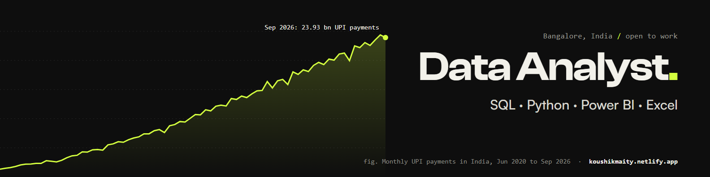

## Hi, I'm Koushik Maity

I'm a data analyst in Bangalore. I take messy real-world data and turn it into answers someone can act on. In one project, 333 products went missing during a CSV load with no error, and I only found it because I check the data before I trust it.

Open to Data Analyst roles in Bangalore or remote, and I can join immediately. I'm currently preparing for Microsoft's PL-300 (Power BI Data Analyst).

**Tools:** SQL (MySQL, PostgreSQL) · Python (Pandas, NumPy, Matplotlib, Seaborn) · Power BI (DAX, Power Query) · Excel · Git

### Projects

| Project | Tool | What I found |
|---|---|---|
| [UPI Payments Dashboard](https://github.com/koushikxy/upi-payments-dashboard) | Power BI | 76 months of NPCI data on 140+ apps. PhonePe and Google Pay handle 78% of UPI transactions, but market concentration is the lowest since 2020. |
| [Grocery Reorder Analysis](https://github.com/koushikxy/grocery-reorder-analysis) | MySQL | 33.8M order lines from 3.4M orders. 59% of items are repeats, and 12% of customers place 30% of all orders. |
| [Flight Fare Analysis](https://github.com/koushikxy/flight-price-analysis) | Python | 300k fares across 6 airlines. Booking inside 15 days raises fares ~1.7x, and the airline changes the price by up to 45% on the same route. |
| [Card Payments Dashboard](https://github.com/koushikxy/card-payments-excel-dashboard) | Excel | RBI bank-wise data. UPI QR codes grew 16.5% in a year while card machines fell 14.7%. |

Each project has a full write-up on my [portfolio](https://koushikmaity.netlify.app/): the question, the data, the method and the findings.

### Experience

- Freelance Business Analyst at Turing (2026): reviewed 200+ AI responses a week against quality criteria, with 92% agreement with senior reviewers.
- B.Tech in Computer Science, XIM University (2025).

### Contact

[LinkedIn](https://www.linkedin.com/in/ksmaity/) · [Portfolio](https://koushikmaity.netlify.app/) · ksmaity21@gmail.com
